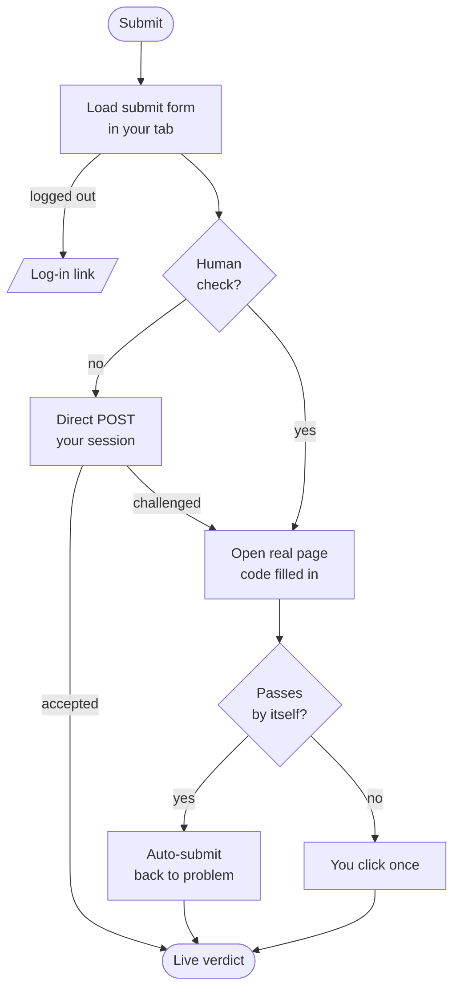

<div align="center">


# CP Submit

### Write, test and submit **Codeforces** & **AtCoder** solutions from your browser's side panel, without getting stuck on anti-bot checks.


**[Features](#features) · [Install](#install) · [How it works](#how-submissions-stay-unstuck) · [Shortcuts](#keyboard-shortcuts) · [Privacy](#privacy--permissions) · [Develop](#development)**

</div>

---

## Why another CP extension?

Tools like *Codeforces Lite* are great until Codeforces asks you to **verify you're human**. The submission then fails over and over, with no way to actually complete the check. CP Submit was built around that failure:

> Every request is made **from inside your own logged-in Codeforces / AtCoder tab**, with your real cookies and your real browser. If the site still wants a human check, CP Submit opens the **real submit page with your code already filled in**. You never retype or re-paste code, and the panel never spins forever.

It does this for **both Codeforces and AtCoder**, from one panel.

---

## Features

<table>
<tr>
<td width="50%" valign="top">

### Submit that doesn't break
- Same-origin submission from the site's own tab
- Automatic fallback to the site's real form when a **Turnstile / Cloudflare** check appears
- Always-available **"Open submit page (code filled in)"** link
- Live verdicts: *In queue → Running on test 7 → Accepted*
- Submit lock and cooldown, so no accidental double submits

</td>
<td width="50%" valign="top">

### Run samples on the real judge
- Uses **Codeforces Custom Invocation** and **AtCoder Custom Test**
- The **exact compiler** your submission will be judged with
- No Judge0, no API keys, no local compilers
- Token-wise output comparison (float tolerance 1e-6)
- Custom tests, plus a timing breakdown for every run

</td>
</tr>
<tr>
<td valign="top">

### An editor you'll like
- **Monaco** (the editor inside VS Code)
- **Vim** key bindings
- Per-language **templates** with a `$0` cursor marker
- Line numbers, cursor style, smooth caret, minimap, word wrap and more
- Languages grouped and sorted, newest compilers first

</td>
<td valign="top">

### Remembers your work
- Code saved **per problem and per language**
- Survives tab switches, navigation and browser restarts
- Keeps your latest 500 problems, oldest dropped first
- Problem timer, Reset to template, one-click cleanup

</td>
</tr>
</table>

### Themes

| | Theme | Mood |
|---|---|---|
|  | **Volcano** | dark maroon with ember-orange accents |
|  | **Cherry Blossom** | soft pink on off-white |
|  | **Midnight** | near-black navy with violet |
|  | **Deep Sea** | deep blue with cyan |
|  | **Sunset** | deep purple with orange |

There are also **Light**, **Dark** and **System** themes. Each theme re-tints both the panel and the editor.

---

## Install

### Browser support

| Browser | Status | Opens as |
|---|---|---|
|  | Supported | Side panel |
|  | Supported | Side panel |
|  | Supported | Side panel |
|  | Supported | Sidebar |
|  | Should work (untested) | Companion window |
|  | Experimental (untested) | Companion window; needs Xcode, see below |

> **On a Mac?** Chrome, Brave, Edge and Firefox all work on macOS, and that's the recommended route today.

### From a release (easiest)

1. Download the zip for your browser from the [**Releases**](../../releases) page.
2. Unzip it.
3. Load it:
   - **Chrome / Brave / Edge:** open `chrome://extensions` (or `brave://` / `edge://`), turn on **Developer mode**, click **Load unpacked** and choose the unzipped folder.
   - **Firefox:** open `about:debugging#/runtime/this-firefox`, click **Load Temporary Add-on**, then pick `manifest.json`.
4. Pin the extension, open any Codeforces or AtCoder problem and click the icon.

### From source

```bash
git clone https://github.com/ionik0/cp-extension.git
cd cp-extension
npm install
npm run build            # → .output/chrome-mv3   (Chrome, Brave)
npm run build:edge       # → .output/edge-mv3
npm run build:firefox    # → .output/firefox-mv2
npm run build:safari     # → .output/safari-mv3   (then convert, below)
```

<details>
<summary><b>Safari (macOS, experimental)</b></summary>

Safari extensions must be wrapped in a macOS app with Xcode:

```bash
npm run build:safari
xcrun safari-web-extension-converter .output/safari-mv3 --app-name "CP Submit"
```

Open the generated Xcode project, run it, then enable the extension in **Safari → Settings → Extensions**. Safari has no side panel, so CP Submit opens as a small companion window.
</details>

---

## How submissions stay unstuck



The extension never fakes a browser, a fingerprint or a check. It sends what your browser would send anyway and lets the site's own page handle verification. Everything has a timeout, and every pending submission keeps an **Open submit page** link.

---

## Keyboard shortcuts

| Action | Keys |
|---|---|
| Run all tests | <kbd>Ctrl</kbd> + <kbd>'</kbd> |
| Submit | <kbd>Ctrl</kbd> + <kbd>Enter</kbd> |
| Reset to template | <kbd>Shift</kbd> + <kbd>Alt</kbd> + <kbd>R</kbd> (press twice) |

These are the same defaults as Codeforces Lite. On macOS, <kbd>Cmd</kbd> works in place of <kbd>Ctrl</kbd>.

---

## Privacy & permissions

**CP Submit collects nothing.** There are no servers, no analytics and no accounts. Your code, templates and settings live in your browser's extension storage. The only sites it talks to are **codeforces.com** and **atcoder.jp**, as you.

| Permission | Why |
|---|---|
| `https://codeforces.com/*`, `https://atcoder.jp/*` | Read problem pages; submit, run tests and read verdicts through your session |
| `scripting` | Make those requests from inside the site's own tab |
| `storage`, `unlimitedStorage` | Save templates, settings and per-problem code locally |
| `sidePanel` | Show the panel (Chromium browsers) |
| `clipboardWrite` | Copy your code when the fallback submit page opens |

It has no access to any other website and does not read your browsing history.

---

## FAQ

<details>
<summary><b>Does it work during live contests?</b></summary>

Yes. It uses the same problem, submit, custom-test and "my submissions" pages that contests use. During big rounds Codeforces enables heavier Cloudflare checks, and CP Submit then uses the real-page fallback, which is a few seconds slower. Before relying on it in a rated contest, try it once in a virtual contest or the AtCoder practice contest.
</details>

<details>
<summary><b>Why is "Run" a few seconds per test?</b></summary>

Tests run on the platform's real judge, which compiles and executes your code. That gives you exact-compiler results, but each run includes the judge's queue and compile time, especially for Java. AtCoder allows one custom test at a time, so samples run one after another. Every result shows a <code>send · wait · polls</code> timing line.
</details>

<details>
<summary><b>Is this allowed?</b></summary>

CP Submit submits **your** code from **your** logged-in browser when **you** click Submit, the same as using the site's form. Always follow each contest's rules, for example on AI-generated code.
</details>

<details>
<summary><b>Where is my code stored, and how do I clear it?</b></summary>

It's in local extension storage, keyed by problem. You can clear it in **Settings → Saved code → Delete all**.
</details>

---

## Development

```bash
npm run dev            # Chrome with hot reload
npm run dev:firefox    # Firefox
npm test               # unit tests (parsers, judging, storage)
npm run compile        # type-check
npm run zip:all        # store-ready zips in .output/
```

```
entrypoints/
  background.ts          opens the side panel / sidebar / companion window
  sidepanel/             the React app
components/              editor (Monaco + Vim), settings, panels, themes
lib/
  platforms/             one file per judge: codeforces.ts, atcoder.ts
  page.ts                runs requests inside the platform tab
  session.ts             submit flow, human-check fallback, verdicts, test runs
  settings.ts            settings, templates, per-problem code memory
  themes.ts              colour themes
```

**Adding a judge** means one new file in `lib/platforms/` that implements the `Platform` interface: parse the problem, describe the submit form, submit, poll verdicts and run a custom test.

---

## Contributing & license

Bugs, ideas and pull requests are welcome. Open an [issue](../../issues) or a [pull request](../../pulls).

Released under the [MIT License](LICENSE).

---

<div align="center">

Inspired by **[Codeforces Lite](https://github.com/MaanasSehgal/Codeforces-Lite)** and built to keep its best parts while never getting stuck on a verification screen.

**If CP Submit saved you a submission, give the repo a star.**

</div>
